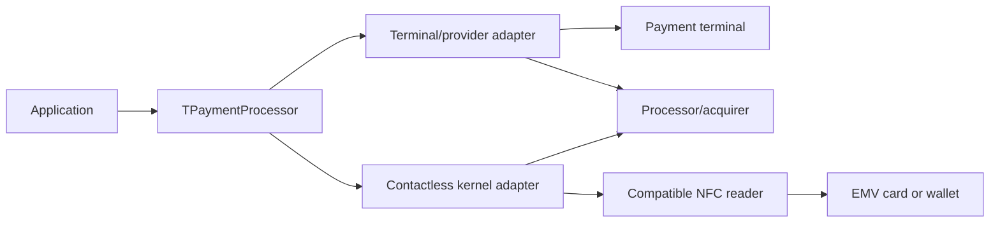

# Payment support: terminal/provider and direct NFC

The component set will support two distinct payment integration routes. Both need a
real processor/acquirer connection. The existing `TEMVCardReader` and
`TContactlessCardReader` provide data/storage operations; this release has no payment
backend, terminal adapter, payment kernel, cryptogram-generation API or live payment
processing. The components below are the next implementation design, not shipped
classes or an assertion that a generic card reader is already a payment terminal.

## Proposed components

| Component/contract | Responsibility |
| --- | --- |
| `TPaymentProcessor` | Validated payment requests, observable lifecycle, cancellation and outcome reconciliation |
| `IPaymentBackend` | Shared contract for provider/terminal and direct-kernel adapters |
| `TTerminalPaymentAdapter` | A selected terminal/provider SDK/API, its events and processor transaction references |
| `TContactlessKernelPaymentAdapter` | A selected EMV contactless kernel and supported NFC reader, plus online processor integration |

The library's inspection helpers remain useful alongside the payment layer; they
must not select/reset a card concurrently with a kernel's live transaction. The
kernel/terminal owns application selection, cardholder verification and complete
transaction sequencing. A direct backend owns transport exclusivity and activation
for the entire card interaction, not separate component transactions per APDU.

## Terminal/provider route

Prefer an integration with a supported terminal SDK/API when deployment uses a
normal payment terminal. The terminal/provider handles its supported card schemes,
contact/contactless processing, PIN or consumer-device verification and payment data
handling according to its integration model. The application supplies a validated
amount/currency and business reference, then receives the processor's transaction
identifier and outcome.

Implementation requires choosing an actual provider, API/version, terminal model
and connection method. Start with its sandbox or simulator. Implement authorization,
decline, cancellation, timeout/disconnection and lookup/reconciliation before live
transactions. Refunds, capture and reversal are separate provider operations with
their own references; they are not emulated by reading a card.

## Direct NFC-reader route

A standalone NFC reader can be a transport for a payment solution when its RF/driver
capabilities, the chosen kernel, supported schemes and the acquirer's integration
requirements permit it. PC/SC enumeration or a successful PPSE read proves neither
those capabilities nor payment acceptance.

Use an actual maintained contactless EMV kernel/provider rather than growing the
inspection reader into a collection of payment APDUs. The kernel handles supported
application selection, terminal data and randomness, risk management, cardholder
verification, scheme-specific cryptogram processing and transaction outcomes.
Processor integration handles online authorization and the prescribed completion,
reversal and settlement paths. A raw card cryptogram or parsed log is not an
authorization response or confirmation of captured funds.

Reader/terminal configurations need the relevant EMV Level 1 (physical communication)
and Level 2 (kernel/application processing) evidence. Payment systems define their
Level 3 end-to-end integration testing. The provider/acquirer determines applicable
scheme, device and payment-data requirements for the chosen deployment. An approved
kernel is not an approval for arbitrary reader hardware or a complete product.
If the chosen reader/kernel cannot meet that configuration, use the terminal route.

Contactless EMV does not imply arbitrary bank-card writes. Issuer-managed keys/files,
issuer scripts, application state changes and payment commands are controlled
protocol operations. They must not be exposed as general MIFARE/NDEF storage writes.
Wallets can return tokens/device verification; do not infer account ownership or a
universal PAN/IBAN from an NFC response.

## Shared payment contract and outcome model

Implement a backend-independent model with these concrete behaviors:

1. Requests contain an integer amount in currency minor units, explicit currency,
   operation type, stable business/idempotency reference and provider configuration.
   Currency exponent comes from a maintained currency definition, not a hardcoded
   two decimals or floating-point amount. Validate before calling the backend.
2. Keep authorization, capture, settlement, reversal and refund separate. Model
   initiated, awaiting card/customer, processing, pending, authorized, declined,
   canceled and unknown outcomes with explicit operation-specific meaning. Do not
   label a read, cryptogram, HTTP success or authorization as a settled payment.
3. After a timeout or lost connection following dispatch, return an unknown/pending
   outcome and reconcile by the stable/provider reference. Never automatically
   resubmit a sale or regenerate a cryptogram. Honor the provider's actual idempotency
   and lookup guarantees; unsupported guarantees cannot be fabricated by an adapter.
4. Cancellation can race with approval. Request cancellation through the backend,
   then reconcile the outcome; a local canceled task is not proof the charge stopped.
5. Persist the minimal business/provider references and status needed for reconciliation.
   Raise status events on a documented caller-thread polling or dispatch model, matching
   the existing non-visual component architecture. Sensitive card/kernel buffers are
   not general-purpose application logs.

Build the first concrete adapter with simulator tests for these behaviors before
adding a second provider or direct kernel. Both routes share the contract; backend
capabilities remain explicit, including refunds, reversals and availability checks.
Do not ship a simulated adapter as if it processed real payments.

## Next implementation order

1. Current release: optional EMV GET DATA/log inspection and an explicit PC/SC
   contactless storage profile for UID/Classic data blocks.
2. Payment request/outcome contract and the first selected provider's sandbox adapter.
3. Provider-specific terminal integration, disconnect/cancellation/reconciliation
   checks, then actual deployment validation with the provider.
4. A selected contactless kernel integration with its supported NFC reader profiles
   and acquirer test environment; add scheme configurations as validated capabilities.
5. In parallel, separate Ultralight/NTAG, DESFire/secure messaging, NDEF and further
   RFID/vendor reader backends. Their storage authentication is separate from payment
   authorization. Existing magstripe and European eID access milestones remain planned.

## Sources

Architecture reviewed against the official
[EMVCo contactless technology page](https://www.emvco.com/emv-technologies/emv-contactless-chip/)
and [EMVCo Level 3 testing explanation](https://www.emvco.com/emv-technologies/emv-level-3-testing/)
on 2026-10-07. See [the EMV reader guide](EMV_READER.md) for the exact limited
inspection profile and [the contactless guide](CONTACTLESS.md) for storage support.
